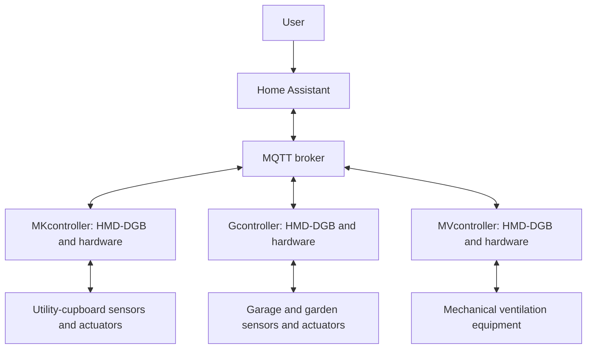

# DGB-systems

DGB-systems connects the generic [HMD-DGB](https://github.com/jvanoosterhout/HMD-DGB) software platform with separately maintained physical nodes. It documents the family-wide context, architecture and design history; the software and hardware implementations remain in their own repositories.

This DGB-systems repository covers system-wide, software and controller concerns. Technical details stay with the implementation repositories; records link back to this repository instead of duplicating them. It aims to learn and practice Systems Engineering skills. 

## Definitions

These are frequently used definition throughout the DGB-systems. 

- **DGB-systems:** The ecosystem of the HMD-DGB software, its controller nodes, physical controllers, Home Assistant and MQTT connections. Avoid using this term for the repository alone; call that the **DGB-systems repository**.
- **HMD-DGB:** The reusable software package. When running on a node, it creates a **service instance**.
- **Node:** The single-board computer (SBC) that hosts an HMD-DGB service instance.
- **Service:** One running instance of the HMD-DGB software on a node; it handles configured device, pin and binding behavior.
- **Controller:** The physical installation that performs sensing and actuation at a location. It includes the node and may include interface circuits, connectors, sensors, actuators and enclosure. 
- **Central home automation platform:** The system providing shared user-facing entities, automations and (where supported) configuration/management of nodes. Home Assistant is the current choice; Homey and Domoticz are examples of alternatives, though they are not part of the current DGB-system.

## Components

| Project | Role |
| --- | --- |
| [HMD-DGB](https://github.com/jvanoosterhout/HMD-DGB) | Generic software package that can bind Raspberry Pi GPIO and Home Assistant device. |
| [MKcontroller](https://github.com/jvanoosterhout/MKcontroller) | Utility-cupboard controller, including doorbell and water-meter use cases. |
| [Gcontroller](https://github.com/jvanoosterhout/Gcontroller) | Garage-door and garden-irrigation controller use cases. |
| [MVcontroller](https://github.com/jvanoosterhout/MVcontroller) | Mechanical-ventilation controller use cases; current hardware documentation is incomplete. |

## System context

Home Assistant provides the user-facing entities and automations. HMD-DGB runs on the controller nodes and connects MQTT devices to GPIO through device, pin and binding configuration. The controller repositories own the concrete wiring, configuration and installation details. See the [system context](docs/system-context.md) for a description of the user needs.

## Documentation

- [Documentation map](docs/README.md)
- [Needs and motivation](docs/system-context.md#needs-and-motivation)
- [Requirements](docs/requirements.md), [design decisions](docs/design-decisions.md) and [design attempts](docs/design-attempts.md)
- [Project history notes](braindump.md) and [documentation migration instructions](instructions.md)

## Status

This is a work in progress repository. 

## License & Disclaimer

This is a personal home automation project shared as-is for educational purposes. Use at your own risk. Electrical work involving relays and/or high voltage should be performed safely and verified before deployment.